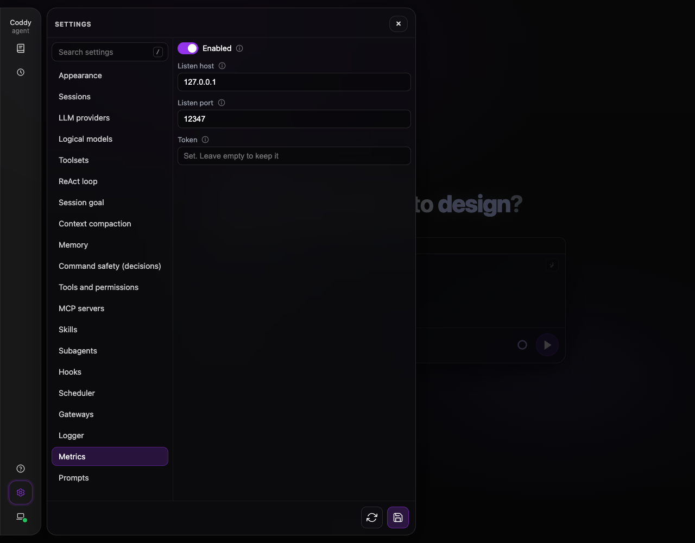
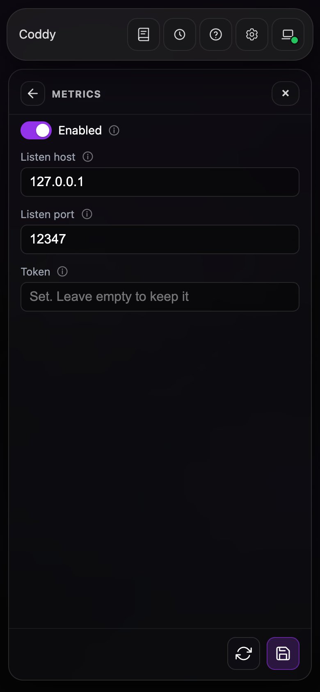

# Monitoring with Prometheus

`coddy serve` can export provider calls, turns, background tasks and the disk of the session store as Prometheus metrics on a port of its own. This page covers enabling the exporter, scraping it, the metrics and the shipped alert rules.

## What the exporter is

The exporter is an auxiliary subsystem of [`coddy serve`](serve.md), off by default: never enough on its own (a configuration that enables only `metrics` is refused) and always free to stop. It needs the `metrics` tag, which the release binaries, the Docker image and the Linux packages carry; a binary without it refuses `metrics.enable: true` and names the tag.

- It serves `GET /metrics` on a listener of its own and shares no route or token with the [HTTP API](../reference/http-api.md).
- Counting starts with the process, whatever `metrics.enable` says, so an exporter enabled later shows what happened before. Counters restart at zero with the process.
- Only `coddy serve` exports, not the console or `coddy acp`.

## Enabling it

```yaml
metrics:
  enable: true
  host: 127.0.0.1   # the default; empty falls back to it
  port: 12347       # the default; 0 falls back to it
  token: "${CODDY_METRICS_TOKEN}"
```

The keys are in the [config reference](../reference/config.md#metrics). With a token set, a scrape without `Authorization: Bearer <token>` gets `401`; the scheme is matched in any case, and `${ENV}` in the token is expanded when the file loads. The **Metrics** tab of the Settings screen (`#/settings/metrics`) edits the same keys; its token field never shows the stored value, and an empty field keeps it.



*The Metrics tab of the Settings screen at 1280 px wide, Dark theme*



*The same tab at 390 px wide, Dark theme*

A [configuration change](serve.md#picking-up-a-configuration-change) applies to the running process with the counters kept: a new token applies from the next scrape, a new `metrics.host` or `metrics.port` rebuilds the listener in place, and `metrics.enable` starts or stops it. A listener that cannot bind stops the exporter alone (`subsystem failed` with `subsystem=metrics` in the log), and Prometheus sees the target down (`CoddyDown`). Run `coddy serve --dry-run` before you move the address: it reports a port another process holds at `metrics.port`.

## Binding beyond loopback

The exporter listens on `127.0.0.1:12347`, which only the machine itself reaches. The figures hold no conversation (see [what is never exported](#what-is-never-exported)) but show load and provider use. To scrape from another machine, set `metrics.host` to a reachable address (`0.0.0.0` for all) and set `metrics.token`. Without a token, a bind beyond loopback (anything but `localhost`, `127.x.x.x` and `::1`) logs a startup warning, and `coddy serve --dry-run` warns at `metrics.host`.

In a container, loopback is the container's own, which a published port cannot reach: bind `0.0.0.0` with a token and publish port `12347`. See [Docker](../getting-started/docker.md#what-the-image-contains-by-default) for the image and [Security and trust](security.md#the-metrics-exporter) for what the token protects.

## Scraping it

```yaml
scrape_configs:
  - job_name: coddy
    authorization:
      type: Bearer
      credentials_file: /etc/prometheus/coddy-metrics-token
    static_configs:
      - targets: ["coddy.example.net:12347"]
```

An exporter on loopback with no token needs no `authorization` block. The [shipped rules](#the-shipped-alert-rules) watch `up{job=~"coddy.*"}`, so begin the job name with `coddy` for `CoddyDown` to cover it. Check by hand first:

```bash
curl -s -H "Authorization: Bearer $CODDY_METRICS_TOKEN" http://127.0.0.1:12347/metrics | head
```

It answers `200` with the exposition text; `401` with `WWW-Authenticate: Bearer realm="coddy-metrics"` for a missing or wrong token; `404` for any path but `/metrics`; and `503` when a third scrape arrives while two run or one runs over 10 seconds.

## What it exports

A scrape asks no provider, bot API or MCP server anything. The `go_*` and `process_*` families come from `github.com/VictoriaMetrics/metrics`, so the set depends on the platform. Coddy adds a generic HELP line to each and leaves them untyped. The tables list Coddy's own families.

### Provider calls

| Family | Type | Meaning |
|--------|------|---------|
| `coddy_llm_attempts_total{provider,model,outcome}` | counter | Provider invocation attempts, retries included. |
| `coddy_llm_attempt_duration_seconds{provider}` | histogram | Attempt duration, the whole stream included. Buckets: 0.5, 1, 2.5, 5, 10, 30, 60, 120, 300, 600 seconds. |
| `coddy_llm_input_tokens_total{provider,model}` | counter | Input tokens the provider reported. |
| `coddy_llm_cached_input_tokens_total{provider,model}` | counter | Cached input tokens, a subset of the input tokens. |
| `coddy_llm_output_tokens_total{provider,model}` | counter | Output tokens the provider reported. |

An **attempt** is one call into a provider that the retry wrapper makes, so a retried call counts once per try. Model listing, usage reads and sign-in are not attempts. Tokens come from the response of an attempt whenever one exists.

Every attempt lands in exactly one `outcome`: `ok`, `canceled` (the caller stopped it), `timeout` (a deadline ran out or the stream stalled), `rate_limited` (HTTP 429), `auth` (401 or 403), `context_overflow` (the prompt does not fit the model's context), `client_error` (any other 4xx), `server_error` (a 5xx, a cut stream, a failed dial or a transient transport error) and `error` (everything else).

### The process

| Family | Type | Meaning |
|--------|------|---------|
| `coddy_turns_started_total`, `coddy_turns_ended_total` | counter | Turns started and ended in this process. |
| `coddy_config_reloads_total` | counter | Replacements of the live configuration. |
| `coddy_build_info{version,revision,goversion,goos,goarch,tags}` | gauge | The running build; the value is 1. |
| `coddy_subsystem_up{subsystem}` | gauge | 1 for a subsystem the process runs or is starting, 0 for one that is enabled and not running; the exporter is left out. |
| `coddy_restart_required` | gauge | 1 when a saved HTTP or swarm address waits for a restart ([Restarting itself](serve.md#restarting-itself)). |
| `coddy_turns_running` | gauge | Sessions with a turn running. |
| `coddy_turn_oldest_running_seconds` | gauge | Age of the longest-running turn, 0 when none runs. A wait for a permission or a usage limit is legitimate, so it proves no hang. |
| `coddy_background_tasks{kind,status}` | gauge | Background tasks of the model by kind (`command`, `agent`, `server`) and status (`queued`, `running`). |
| `coddy_sessions_disk_available_bytes`, `coddy_sessions_disk_size_bytes` | gauge | Free space a non-root writer can use on the disk holding the session store, and its size; absent when the read fails or the process has no session store. |

A **turn** is one run of the agent on a session, on any surface of the process, including one a finished background task wakes.

### Labels and their budget

`provider` is the name of a provider row in `providers[]`, and `model` is the API model id of a model declared in `models[]`, without the provider prefix (`gpt-5`, not `openai/gpt-5`). Anything else is `other`: an undeclared provider is `provider="other", model="other"`, and an undeclared model of a declared provider is `model="other"`.

Labels are decided when an attempt is observed, against the live configuration. The first 16 provider names and the first 64 named provider and model pairs keep their own label, and every later one is `other`. An admitted name stays admitted, so a reload, a rename or a removal never takes a series from a counter, and a restart starts a fresh budget. At the bound, Coddy's own families add up to about 1,200 series.

At start and at every configuration reload, each admitted provider gets `coddy_llm_attempts_total` at zero for every outcome, once per declared model and once for `other`, so a rate over its first failure has a sample to start from. The other families have no seeds.

### Reading the numbers

A scrape reads the families one after another, so they describe slightly different moments: within one scrape `coddy_llm_attempts_total` and the `_count` of `coddy_llm_attempt_duration_seconds` may differ, and started minus ended turns need not equal `coddy_turns_running`. Only a histogram's `_count` equals its own `+Inf` bucket. Compare families over a window with `rate()` or `increase()`, not as a pair of instants.

## The shipped alert rules

[`examples/prometheus/coddy-rules.yml`](../../examples/prometheus/coddy-rules.yml) holds five alerts in one group named `coddy`; load it with `rule_files`:

| Alert | Severity | Fires when |
|-------|----------|------------|
| `CoddyDown` | critical | `up{job=~"coddy.*"}` is 0 for 5 minutes |
| `CoddyDiskLow` | warning | `coddy_sessions_disk_available_bytes` is below 512 MiB for 5 minutes |
| `CoddyProviderFailing` | warning | over 20% of one provider's attempts in 15 minutes ended `server_error`, `timeout`, `auth` or `rate_limited`, out of over 10, for 10 minutes |
| `CoddyTurnLongRunning` | info | `coddy_turn_oldest_running_seconds` is above one hour |
| `CoddyRestartRequired` | warning | `coddy_restart_required` is 1 for 10 minutes |

CI tests them on every pull request. [`examples/prometheus/coddy-rules.test.yml`](../../examples/prometheus/coddy-rules.test.yml) holds cases that must fire and cases that must stay quiet for every rule; run them with `promtool test rules examples/prometheus/coddy-rules.test.yml`.

## What is never exported

The exporter reports counts, durations and state, never a prompt, model output, session id or title, workspace folder, tool name or other content of a conversation. Every label value is a member of a closed set (an outcome, a task kind or status, a subsystem name, the build tags, the Go version, the OS, the architecture) or a name from your configuration (a provider row, a declared model id), so keep those free of anything you would not put in a dashboard. The token is never exported, and `GET /coddy/config` reports only whether one is set.

## Relays and other processes

A swarm relay does not carry the exporter of the nodes behind it: a mount refuses `/metrics`, and the relay serves no metrics of its own. Every `coddy serve` has its own exporter on its own port, so scrape each node directly and put the nodes of one relay in one Prometheus job with a target for each.
